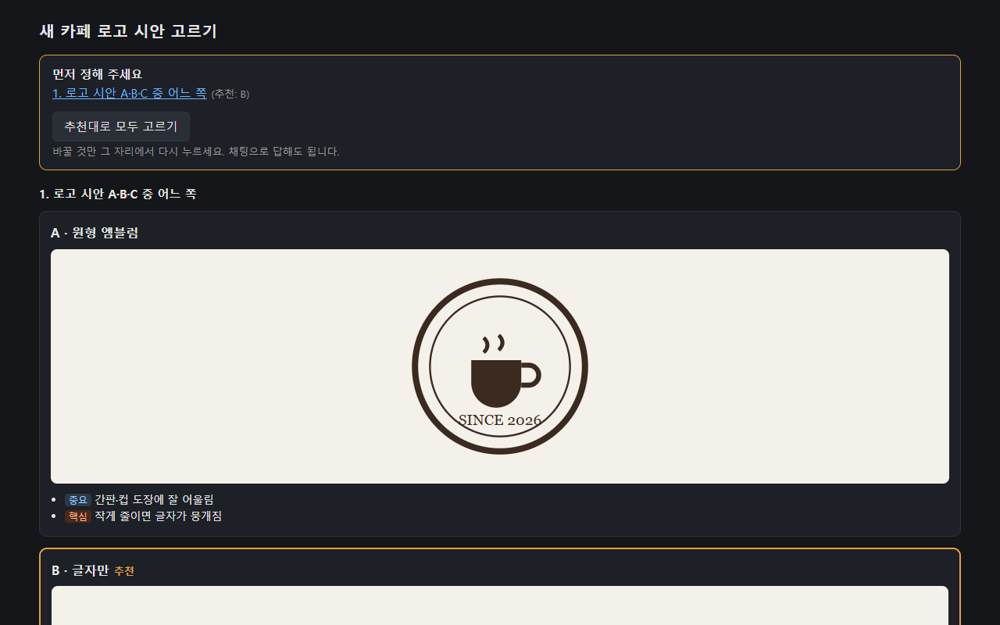
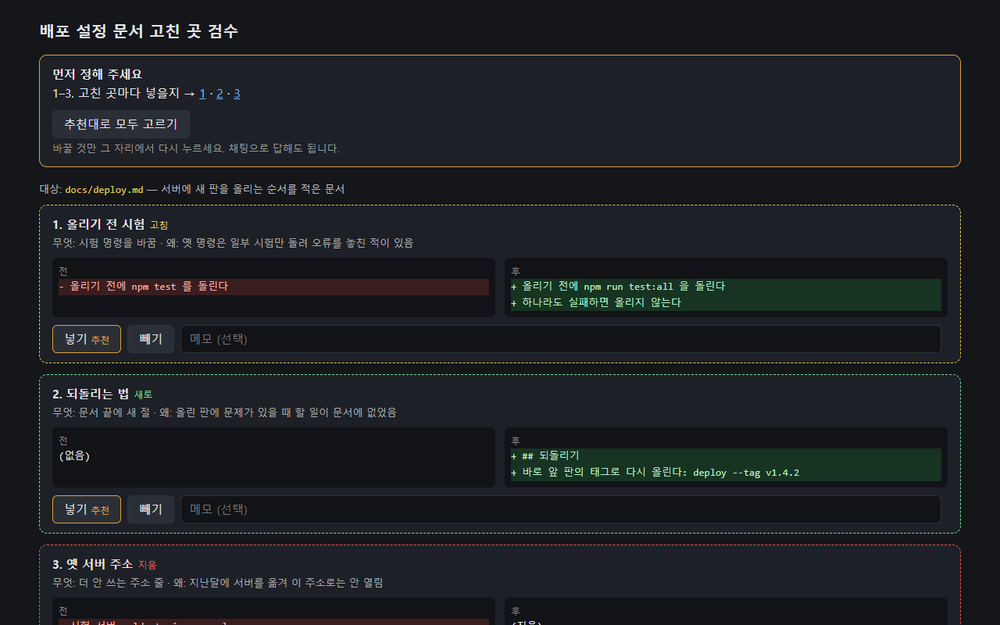

# skills

AI 에이전트(Claude Code 등)용 스킬 모음입니다. 스킬 하나 = `skills/<이름>/` 폴더 하나이고, 폴더 안의 `SKILL.md`가 에이전트가 읽는 지침입니다.

| 스킬 | 한 줄 |
|---|---|
| [review-pages](#review-pages) | 에이전트가 결정을 물을 때, 채팅 글 대신 눌러서 고르는 웹페이지 한 장으로 보여 주게 함 |

---

## review-pages

### 왜 필요한가

에이전트에게 일을 시키다 보면 「A안·B안·C안 중 뭘로 할까요?」, 「12곳을 고쳤는데 다 넣을까요?」처럼 중간에 사람이 정해야 할 것이 계속 나옵니다. 이걸 채팅 글로 받으면:

- 긴 글을 읽고 비교하느라 눈이 아프고
- 화면 시안·그림·목소리처럼 **보거나 들어야 고를 수 있는 것**은 글로는 비교가 안 되고
- 「1번은 넣고 3번은 빼고…」를 다시 글로 쳐야 합니다

이 스킬을 넣으면 에이전트가 그런 순간에 **HTML 페이지 한 장**을 만들어 주소를 줍니다. 보기마다 실제 모양(그림·화면·소리)과 좋은 점·걸리는 점이 카드로 나오고, 에이전트의 **추천이 표시**되어 있어서, 추천만 훑어보고 **「추천대로 모두 고르기」 한 번**으로 끝낼 수도 있습니다.

A/B 테스트(손님에게 두 판을 보여 주고 반응을 재는 것)와는 다릅니다. 작업하는 **나와 에이전트 사이**에서, 에이전트가 낸 안을 내가 빨리 고르고 승인하는 화면입니다. 그림만이 아니라 글·코드·설정을 고친 것도 전·후로 보여 줍니다.

### 이럴 때 페이지가 나옵니다

| 장면 | 페이지 |
|---|---|
| 앱 화면 배치 시안 2–3개 중 고르기 | 시안마다 실제 화면 그림 + 추천 |
| 로고·썸네일·삽화 후보 고르기 | 후보 그림을 크게, 누르면 화면 가득 |
| 영상·TTS 목소리 후보 고르기 | 카드마다 재생 버튼 |
| 에이전트가 문서·설정·코드 여러 곳을 고친 것 승인 | 고친 곳마다 전·후 나란히, 곳마다 넣기/빼기 |
| 작업 순서 계획 검토 | 단계마다 정함 / 가정 / 정해 주실 것 |
| 조사·분석 결과 보고 | 결론을 맨 위에, 그래프·스크린숏을 옆에 |

값 하나 고르기나 한두 줄 고친 것처럼 **글로 충분한 것은 페이지 없이 채팅으로** 묻습니다(에이전트가 판단). 「페이지로 보여 줘」라고 하면 언제든 만듭니다.

### 쓰는 흐름

1. 에이전트가 페이지를 만들고 채팅에 `http://127.0.0.1:8765/...` 주소를 줍니다 (내 컴퓨터 안에서만 열리는 주소)
2. 주소를 눌러 열고, 보기 버튼을 누르거나 「추천대로 모두 고르기」를 누릅니다. 메모 칸에 한마디 적어도 됩니다
3. 채팅에 **「골랐어」**라고만 씁니다 — 에이전트는 채팅이 와야 움직이므로 이 한마디가 필요합니다
4. 에이전트가 누른 것을 읽고 이어서 작업합니다 (채팅으로 「1은 B, 3은 빼」처럼 답해도 됩니다)

### 예시

**고르기** — 보기마다 카드, 좋은 점·걸리는 점에 무게 표시, 추천 하나와 추천 이유

**바뀐 것 검수** — 고친 곳마다 전·후를 나란히, 색으로 종류(고침·새로·지움), 곳마다 넣기/빼기

위는 그림이라 눌러지지 않습니다. 직접 눌러 보려면 [docs/example_pick.html](docs/example_pick.html)·[docs/example_diff.html](docs/example_diff.html)을 열고 오른쪽 위 「Download raw file」(아래 화살표 아이콘)로 받아 브라우저에서 여세요. 이렇게 파일로 열면 버튼 모양만 바뀌고 「기록 안 됨」이 뜹니다 — 실제로 쓸 때는 에이전트가 기록 서버로 띄워 줍니다.

### 설치

1. 이 저장소를 받습니다 — `git clone https://github.com/none78673-cpu/skills.git` 또는 초록 「Code」 버튼 → 「Download ZIP」 후 압축 풀기
2. 그 안의 **`skills/review-pages` 폴더 자체**를 에이전트의 스킬 폴더에 넣습니다 (`skills` 폴더째 넣으면 안 잡힙니다). Claude Code라면 최종 경로가 이렇게 되어야 합니다:
   - Windows: `C:\Users\<내 이름>\.claude\skills\review-pages\SKILL.md`
   - macOS·Linux: `~/.claude/skills/review-pages/SKILL.md`
   - 한 프로젝트에서만 쓰려면 그 프로젝트의 `.claude/skills/review-pages/SKILL.md`
3. Python 3이 필요합니다 (페이지를 띄우는 서버). 페이지를 주기 전에 화면을 자동 점검하는 기능은 선택이며, 쓰려면 `pip install playwright` 후 `playwright install chromium` (macOS·Linux는 `pip3`·`python3`)
4. Claude Code를 다시 시작하고 확인합니다 — 「review-pages 스킬로, 점심 메뉴 후보 3개를 고르기 페이지로 보여 줘」라고 해 보세요. 주소가 오면 설치된 것입니다

### 들어 있는 것

| 파일 | 하는 일 |
|---|---|
| [SKILL.md](skills/review-pages/SKILL.md) | 에이전트가 따르는 지침 (언제 만드나, 페이지 종류별 모양, 띄우는 법) |
| [scripts/serve_pages.py](skills/review-pages/scripts/serve_pages.py) | 내 컴퓨터에서만 열리는 서버 + 소리·영상 위치 이동 + 누른 것 기록 |
| [scripts/check_page.py](skills/review-pages/scripts/check_page.py) | 주기 전 점검 (안 열림·오류·가로 넘침·첫 화면 스크린숏) — 선택 |
| [scripts/pick_example.html](skills/review-pages/scripts/pick_example.html) | 고르는 버튼·추천·기록이 들어 있는 최소 틀 |
